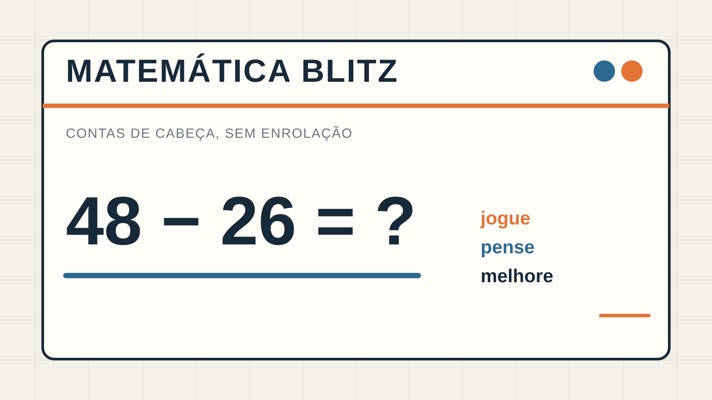

# Matemática Blitz

<div align="center">
  <a href="https://gabrielaraujo-eng.github.io/matematica-blitz/">
    
  </a>
  <p><strong>Um jogo de contas rápidas para treinar as quatro operações contra o relógio.</strong></p>
  <p>
    <a href="https://gabrielaraujo-eng.github.io/matematica-blitz/">▶ Jogar agora</a> ·
    <a href="#como-jogar">Como jogar</a> ·
    <a href="#modos">Modos</a> ·
    <a href="#pontua%C3%A7%C3%A3o">Pontuação</a>
  </p>
</div>

## Por que este jogo

Matemática Blitz nasceu como um jeito simples de praticar cálculo mental: uma partida curta, teclado na mão, cronômetro correndo e um recorde pessoal para tentar melhorar. É um único arquivo HTML, sem servidor, sem conta e sem coleta de dados.

## Como jogar

- Escolha um **modo** e uma **dificuldade**, marque as operações que quer treinar e clique em **Começar partida**.
- Digite o resultado com o mouse, no teclado numérico da tela ou no teclado físico.
- A resposta é conferida **sozinha** no instante em que ficar correta: não precisa esperar nem apertar Enter.
- Acertos seguidos aumentam o **combo**, que aumenta o bônus de pontuação. Errar, pular ou deixar o tempo estourar zera o combo.
- Todo o progresso (nível, recordes, estatísticas e conquistas) fica salvo apenas no `localStorage` do navegador.

### Teclas

| Tecla | Ação |
| --- | --- |
| `0` a `9` | digitar a resposta |
| `Enter` | confirmar quando a resposta estiver errada por completo |
| `Backspace` | apagar um dígito |
| `-` | inverter o sinal (dificuldade Insano pode dar negativo) |
| `P` | pausar e retomar |
| `S` | pular a conta |
| `Esc` | pausar / sair da partida |

## Modos

| Modo | Regra | Objetivo |
| --- | --- | --- |
| **Relâmpago** | 60 segundos corridos | acertar o máximo de contas possível |
| **Sobrevivência** | tempo por conta, que encolhe com o combo, e três vidas | aguentar o máximo de rodadas |
| **Maratona** | 20 contas, cronômetro somando | terminar no menor tempo total |
| **Treino livre** | sem cronômetro, com a conta completa explicada | estudar sem pressão |
| **Desafio do dia** | as mesmas 15 contas para todo mundo, geradas a partir da data | comparar com o próprio recorde diário |

## Dificuldades

| Dificuldade | Números | Base de pontos | Tempo por conta |
| --- | --- | --- | --- |
| Fácil | até 20, tabuada até 5, sem divisão | 100 | 10 s |
| Médio | até 60, tabuada até 9, divisões exatas | 160 | 8 s |
| Difícil | até 180, tabuada até 13, contas de dois passos ocasionais | 240 | 6,5 s |
| Insano | até 650, dois passos com parênteses, resultado pode ser negativo | 330 | 5,2 s |

## Pontuação

```text
pontos = base da dificuldade
       + bônus de velocidade  (base × 0,55 × fração de tempo restante × multiplicador)
       + bônus de combo       (min(combo, 30) × 9)
```

Cada partida concede **XP** igual a `pontos ÷ 12`. A cada 400 XP o nível sobe, e o título passa por Começando, Praticante, Bom de conta, Rápido de cabeça, Mestre das contas, Veterano e Sem calculadora.

## Estatísticas e conquistas

A tela **Meu progresso** guarda nível, XP total, partidas, contas respondidas, precisão vitalícia, maior combo, tempo jogado, recordes por modo e dificuldade e as 10 conquistas:

Primeira partida · Combo de 10 · Sequência relâmpago · Precisão absoluta · Cinco mil pontos · Nível 5 · Insano domado · Tabuada invertida · Maratonista · Compromisso diário.

## Tecnologias

- HTML5, CSS3 e **JavaScript puro** (ES5 compatível, sem frameworks e sem dependências externas).
- Geração de contas com faixas por dificuldade e divisões sempre exatas.
- `mulberry32` com semente derivada da data para o Desafio do dia ser igual para todos.
- Animação por `requestAnimationFrame`, anel de tempo desenhado em SVG.
- Efeitos sonoros sintetizados com Web Audio API (nenhum arquivo de áudio no repositório).
- `localStorage` versionado (`mb.settings.v1`, `mb.profile.v1`) com tolerância a dados antigos.
- Layout responsivo, `prefers-reduced-motion`, `aria-live`, foco visível e contraste elevado.
- Gráficos e ícones em SVG inline, sem emojis no texto da interface.

## Jogar localmente

Por ser estático, basta abrir o arquivo:

```bash
git clone https://github.com/gabrielaraujo-eng/matematica-blitz.git
cd matematica-blitz
python3 -m http.server 8080
# abra http://localhost:8080
```

## Publicação

O workflow [`.github/workflows/pages.yml`](.github/workflows/pages.yml) publica a pasta na branch `main` no GitHub Pages, habilitando o serviço automaticamente na primeira execução. Endereço final:

`https://gabrielaraujo-eng.github.io/matematica-blitz/`

## Estrutura

```text
index.html                  jogo completo (HTML + CSS + JavaScript em um arquivo)
assets/matematica-blitz-cover.svg capa do repositório
assets/matematica-blitz-card.svg  arte quadrada usada no card do perfil
.github/workflows/pages.yml publicação no GitHub Pages
```

## Licença

Uso livre para estudo e portfólio. Criado por [Gabriel Araújo](https://github.com/gabrielaraujo-eng).
